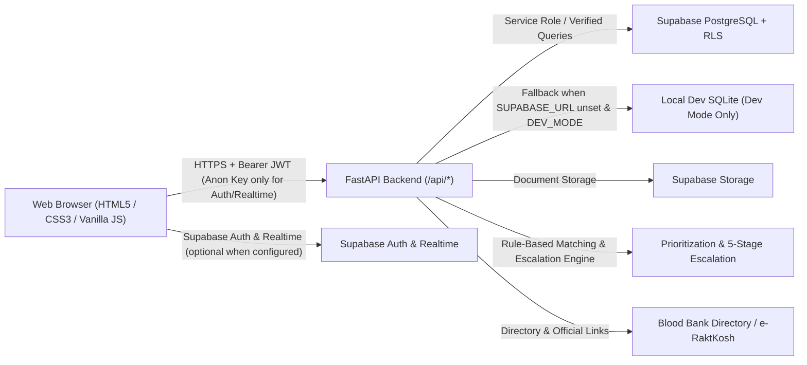
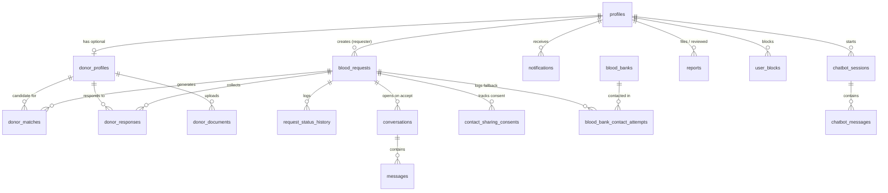

# LifeLink Architecture & Database Design

**Project:** LifeLink — Smart Blood Donor Matching & Emergency Response System  
**Team:** LogicLoom | **Institution:** GL Bajaj Group of Institutions, Mathura

---

## 1. System Architecture

LifeLink follows a layered, privacy-first architecture where **FastAPI** enforces business logic, role-based authorization, matching, escalation, and PII protection, while **Supabase** provides PostgreSQL persistence, Row Level Security (RLS), Authentication, Realtime updates, and Document Storage.

### Security & Trust Boundaries

1. **Frontend (`frontend/`)**: Never receives `SUPABASE_SERVICE_ROLE_KEY`. Public config endpoint (`/api/config/public`) returns only `supabase_url`, `supabase_anon_key`, `dev_auth_mode`, and `phone_otp_enabled`.
2. **Backend (`backend/`)**: Validates every JWT token on protected routes, resolves the authenticated user's profile and role from the database (never from client-supplied `user_id` or `role` headers/fields), strips private contact fields (`phone_number`, `email`, exact addresses) from public and donor-search responses, and enforces rate limits and consent rules.
3. **Database (`supabase/`)**: RLS is enabled on every table. Users cannot escalate their own `role` to `admin` or alter `account_status`.

---

## 2. Entity-Relationship Diagram

---

## 3. Core Workflow Lifecycle

### Blood Request Statuses
`created` -> `matching` -> `donors_notified` -> `responses_received` -> `connection_in_progress` -> (`blood_bank_assistance` -> `escalation_in_progress`) -> `fulfilled` | `unresolved` | `cancelled` | `expired`

### 5-Stage Progressive Escalation
1. **Stage 1:** Nearby potentially compatible available donors.
2. **Stage 2:** Additional nearby candidates.
3. **Stage 3:** Wider geographical search radius.
4. **Stage 4:** Verified Blood-Bank Directory & official resources (e.g., e-RaktKosh).
5. **Stage 5:** Hospital-coordinated wider search & treating hospital transfusion service guidance.

---

## 4. Phase 1–3 Add-On Extensions Implemented

- **Database Migrations & RLS:** Additive migrations and row-level policies live in `supabase/migrations/002_phase1_addons.sql`, `003_phase2_addons.sql`, `004_phase3_addons.sql` and `supabase/policies/002_phase1_rls.sql`, `003_phase2_rls.sql`, `004_phase3_rls.sql` (with full SQLite parity in `backend/app/addons_phase1_db.py`, `addons_phase2_db.py`, and `addons_phase3_db.py`).
- **Phase 1 (Essential Usability):** Quick Emergency Request UX with review-before-submit and attribution, Hospital Verification (`hospitals`, `hospital_verification_documents`, `hospital_verification_history`), Live 8-Step Request Tracking (`/api/requests/{id}/tracking-summary`), Scoped Emergency Coordinators (`/api/coordinators/*`), Blood Bank stock labels & updates, and donor/coordinator notifications on request cancellation and expiry.
- **Phase 2 (Accessibility & User Experience):** English (`en`) & Hindi (`hi`) UI localization preserving form values, Accessibility toolbar (font scaling & high contrast), Donor Availability Calendar & Quiet Hours (`donor_availability`, `user_notification_preferences`), Family Emergency Accounts (`/api/family/*`), and Privacy-Safe Public Request Sharing (`/api/share/*`, `/api/public/shared/{token}`).
- **Phase 3 (Trust & Engagement):** Transparent Donor Trust Profile (`GET /api/donors/{id}/trust-profile` distinguishing verified vs self-declared metrics without clinical ranking), Multi-type Donation History with correction logs & reminders, and Community Referrals + Voluntary Appreciation Cards (`/api/referrals/me`, `/api/donors/me/appreciation`).
- **Phase 4 (Integration Readiness & Regional Localization):** Configuration-gated integration endpoints under `/api/integrations/*` (`status`, `eraktkosh/sync`, `masked-call/{request_id}/initiate`, `push/dispatch` returning explicit `501` until external credentials are provided), verified partner hospital discovery (`/api/hospitals/verified`), and extensible 5-language localization (`en`, `hi`, `mr`, `bn`, `ta`).
